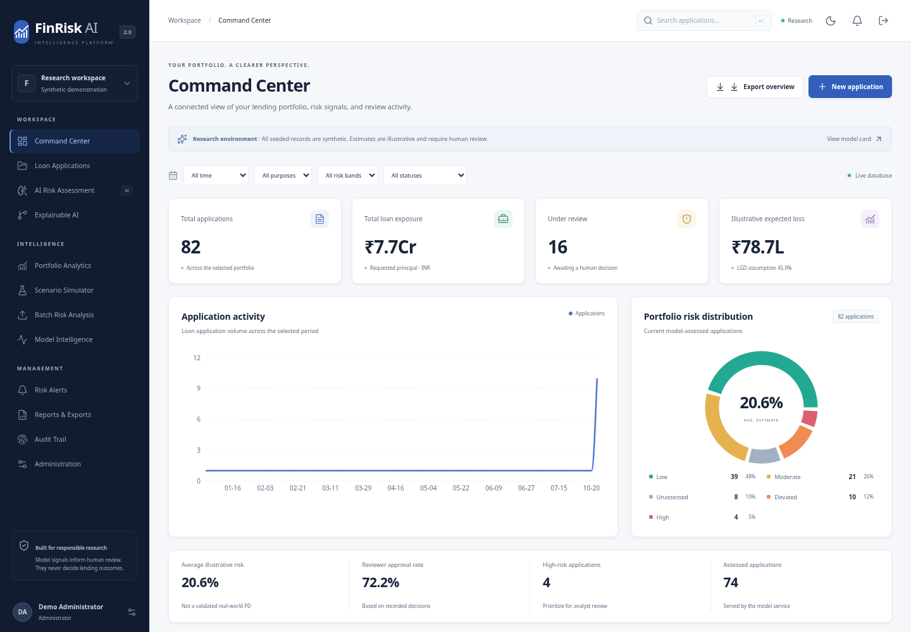
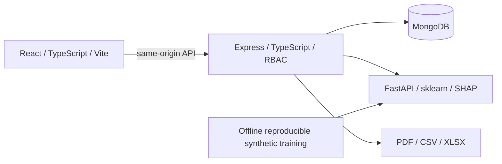

# FinRisk AI 2.0

**Intelligent Credit Risk. Explainable Decisions. Smarter Lending.**

An educational financial risk intelligence application with a React analyst workspace, a MongoDB-backed Express API and a separately trained Python inference service. Applications, assessments, scenarios, batches, alerts and review history persist in MongoDB. Charts and exports read the actual backend rather than frontend fixtures.

> **Research demonstration:** seeded identities and training data are synthetic. Model outputs estimate a defined synthetic adverse outcome, **not independently validated real-world default probabilities**. Approval and rejection are human reviewer actions with recorded reasons. No regulatory approval, bureau integration or production lending fitness is claimed.



## Product workflow

- Twelve connected workspaces: Command Center, Loan Applications, AI Risk Assessment, Explainable AI, Portfolio Analytics, Scenario Simulator, Batch Risk Analysis, Model Intelligence, Risk Alerts, Reports & Exports, Audit Trail and Administration.
- Draft → submit → trained-model assessment → explain → manual review with reasons. Editing assessed inputs invalidates the current assessment and requires reassessment.
- INR financial calculations, optional Indian-style credit score **300–900**, zero-interest EMI handling, exposure and illustrative expected loss with disclosed assumptions.
- Real local SHAP contributions, reproducible model comparison, held-out evaluation and calibration plots. No paid AI provider is required; the copilot uses deterministic grounded summaries.
- Persisted scenario comparisons, bounded asynchronous CSV/XLSX jobs with partial failure reporting, alert acknowledgment/resolution, and data-backed PDF/CSV/XLSX exports.
- HTTP-only authentication cookies, password hashing, four server-enforced roles, validation, rate limits, request IDs and audit records.

## Architecture



| Directory                    | Purpose                                                                                  |
| ---------------------------- | ---------------------------------------------------------------------------------------- |
| `frontend/`                  | Responsive React SPA, TanStack Query, React Router, Tailwind, Radix primitives, Recharts |
| `backend/`                   | Express API, Mongoose schemas, auth, workflows, batch processing and exports             |
| `ml-service/`                | FastAPI inference, financial features, training, model artifacts and Python tests        |
| `datasets/`                  | Labeled synthetic dataset, provenance notes and upload examples                          |
| `tests/`                     | Cross-service Playwright API and browser workflows                                       |
| `scripts/`                   | Local initialization, development orchestration and health polling                       |
| `shared/`, `docs/`, `infra/` | Contracts, architecture, model card, deployment and operational guidance                 |

## Quickest local start: Docker

Prerequisites: Git, Node.js 24 (for local credential generation) and Docker Desktop with Compose v2. On Windows use Linux containers.

```powershell
git clone https://github.com/dhavalmistry2006-arch/FinRiskAi.git
cd FinRiskAi
git switch revamp/finrisk-ai-v2
# These clone commands assume the v2 branch has been published to your remote.
node scripts/init-demo.mjs
docker compose up --build -d
docker compose exec backend node dist/seed.js
```

The initializer preserves existing settings and generates random local credentials in the ignored root `.env`. Open that file locally to obtain `DEMO_PASSWORD`; do not commit or share it. Sign in with `admin@finrisk.demo`, `analyst@finrisk.demo`, `reviewer@finrisk.demo` or `viewer@finrisk.demo` and your configured password. Use `http://localhost:3001` on your own machine. MongoDB is not published to the host by Compose.

```powershell
docker compose ps
docker compose logs backend ml-service
docker compose stop
docker compose start
```

The database persists in the named volume. `docker compose down` preserves it; `docker compose down -v` permanently removes demo data. Seeding is non-destructive and skips existing demonstration identifiers, so it does not reset an existing password or silently replace modified applications.

## Native development — Windows PowerShell

Use Node.js **24**, Python **3.12**, Git and Docker Desktop (or your own local MongoDB 7). Run from the repository root. Only MongoDB runs in Docker in this path.

```powershell
node scripts/init-demo.mjs --native
npm ci
npm run setup
docker run -d --name finrisk-dev-db -p 127.0.0.1:27017:27017 -v finrisk-dev-data:/data/db mongo:7 --bind_ip_all
py -3.12 -m venv ml-service/.venv
& ./ml-service/.venv/Scripts/python.exe -m pip install -r ml-service/requirements.lock.txt
Push-Location ml-service
& ./.venv/Scripts/python.exe train.py
Pop-Location
npm run dev
```

In a second PowerShell window, after services are healthy:

```powershell
npm run seed
Invoke-RestMethod http://localhost:5000/health
```

`npm run dev` starts Python inference (8000), Express (5000), and Vite (3001). Stop with Ctrl+C. To start individually:

```powershell
# Terminal 1
cd ml-service
& ./.venv/Scripts/python.exe -m uvicorn app.main:app --host 127.0.0.1 --port 8000
# Terminal 2, from repository root
npm --prefix backend run dev
# Terminal 3, from repository root
npm --prefix frontend run dev
```

Linux/macOS use `python3 -m venv ml-service/.venv` and `ml-service/.venv/bin/python` instead of the Windows executable. No virtual-environment shell activation is required. Do not overwrite an existing `backend/.env`; merge missing settings instead.

## Configuration

Templates are in `.env.example` and `backend/.env.example`. The frontend uses the same-origin `/api/v1` proxy and never needs database or authentication secrets. Backend native commands run with working directory `backend/` and load `backend/.env`. Compose reads root `.env` and injects container-specific service addresses.

| Variable         | Purpose                                                                           |
| ---------------- | --------------------------------------------------------------------------------- |
| `JWT_SECRET`     | Random signing secret, at least 32 characters; never a frontend variable          |
| `DEMO_PASSWORD`  | Operator-selected demo seed password, at least 12 characters                      |
| `MONGODB_URI`    | Persistent database connection                                                    |
| `ML_SERVICE_URL` | Internal Python inference base URL                                                |
| `CORS_ORIGIN`    | Explicit browser origin allowlist, comma-separated where needed                   |
| `COOKIE_SECURE`  | `false` only for local HTTP; use `true` behind production TLS                     |
| `ML_SERVICE_KEY` | Optional internal service authentication; configure consistently on both services |

Do not invent API keys or supply secrets through chat. The core product requires no external LLM credentials.

## Validation

```powershell
npm run build
npm run lint
npm test
Push-Location ml-service
& ./.venv/Scripts/python.exe -m pytest
Pop-Location
npx playwright install chromium
npm run test:e2e
npm run audit:dependencies
```

Run end-to-end tests with the seeded services already running. Tests read `DEMO_PASSWORD` from the environment or ignored local config; they never print it. For an existing Linux Chromium, use `$env:CHROMIUM_PATH="/usr/bin/chromium"` in PowerShell or `CHROMIUM_PATH=/usr/bin/chromium npm run test:e2e` in Bash. Backend integration tests use an isolated test database and must never target a production database. See [test evidence](docs/TESTING.md) for executed results and limitations.

## API and ML

- Express OpenAPI: `/api/v1/openapi.json`; documentation entry: `/api/v1/docs`.
- Portfolio monitoring: `/api/v1/monitoring` reports descriptive PSI; low sample sizes are labeled unavailable.
- Inference: `POST /predict`, `/predict/batch`, `/explain`; `GET /model/info`, `/health`. Keep these internal.
- [API reference](docs/API.md), [architecture](docs/ARCHITECTURE.md), [database schema](docs/DATABASE_SCHEMA.md).
- [Training pipeline](docs/ML_PIPELINE.md) and [model card](docs/MODEL_CARD.md) define the target, evaluation split, model comparison, explanation scale and population limitations.
- Retraining is an explicit offline `python train.py` action. Do not retrain in response to an analyst request or silently replace deployed model artifacts.

## Demonstration walkthrough

1. Initialize synthetic records and sign in as an analyst or administrator.
2. Explore the Command Center; filter and drill down to an application.
3. Create a fictitious applicant, save a draft, submit and run assessment.
4. Inspect financial ratios, SHAP factors and model version. Use the grounded assistant for a stored-data summary.
5. Open a scenario, adjust income/principal/tenure, compare and save it.
6. Upload the provided CSV or XLSX template to batch analysis, inspect valid/invalid rows and download results.
7. Review and acknowledge risk alerts. Export an assessment or portfolio report.
8. Sign in as a reviewer, record a reasoned decision, and inspect Audit Trail.
9. Restart services and confirm saved applications and assessments remain.
10. Sign in as the read-only viewer to verify mutations and restricted exports are denied.

## Limitations and next steps

This is a research-grade portfolio implementation, not an institution-ready lending engine. Synthetic held-out performance does not establish external validity or fairness. The current model accepts INR only; other currencies require explicitly validated conversion and population handling. Model drift indicators describe distribution differences, not prediction accuracy without labeled outcomes. Batches execute in the backend process rather than a distributed job system. Standalone MongoDB workflows are not multi-document ACID transactions. The default local container database is isolated but unauthenticated; production requires managed database authentication and TLS. Enterprise multi-tenancy, SSO/MFA, immutable audit storage, scheduled reporting and real-world validation are future work.

See [deployment](docs/DEPLOYMENT.md), [security](docs/SECURITY.md), [contributing](CONTRIBUTING.md), [change log](CHANGELOG.md) and the original [recovery audit](docs/AUDIT.md). Screenshots and test results are generated from the running application; unsupported capabilities are not claimed as verified.
