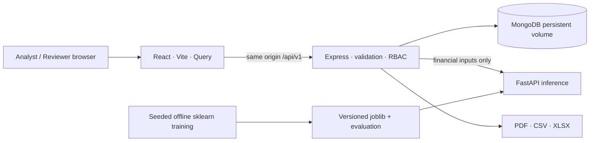
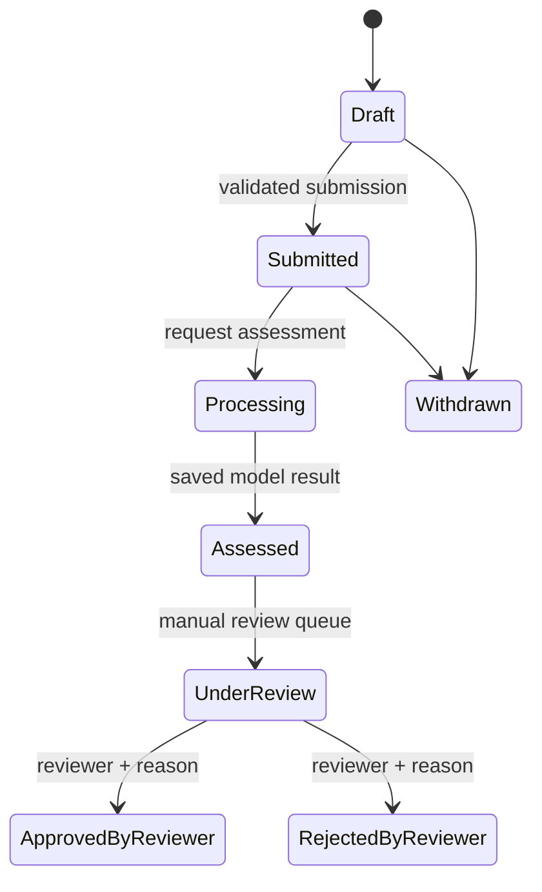

# Architecture

The browser never receives database credentials, signing keys, or direct database access. The backend authenticates requests before reading or changing records. MongoDB is the primary store for users, applications, assessments, scenarios, batch jobs, alerts, settings and audit records. No in-memory persistence fallback exists.

Model artifacts are built offline using a reproducible synthetic population. Inference loads an artifact and fails explicitly if unavailable. Retraining is an operator command, never a hidden request-side action. The Python service needs no applicant name. Computed model contributions accompany individual predictions.

The API's enumerated status strings include spaces (for example `Under Review`). Model risk bands do not themselves approve or reject a loan. A reviewer action is recorded with a reason. Updates and exports are auditable. Operations spanning multiple collections are not assumed to be transactional on standalone MongoDB: deployment must use a replica set before introducing multi-document transactions. See the backend implementation and testing notes for exact atomicity limits.

Development uses Vite's API proxy. Containers use nginx's API proxy. Only the frontend is published by default, bound to host loopback. A production reverse proxy must supply TLS and secure cookies. Background batch execution is bounded and asynchronous but runs in the API process; it is not a distributed durable worker queue.
