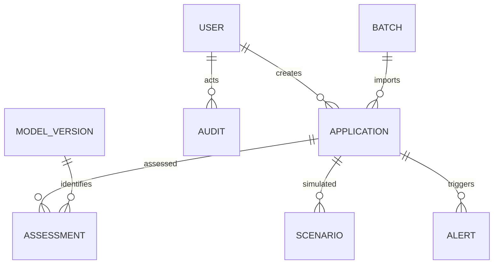

# MongoDB schema

MongoDB is the primary persistent store. Mongoose models are authoritative in `backend/src/models.ts`. All application-level writes use the API; training datasets are files and do not replace MongoDB records.

- **Users:** unique normalized email, name, password hash (excluded from API serialization), role, active status and token version for revocation.
- **Applications:** unique applicant reference, minimized demonstration identity, validated financial inputs, INR currency default, status, latest assessment reference and append-only workflow history.
- **Assessments:** application reference, model version, threshold policy version, synthetic probability, band, financial ratios, contributions, warnings and original structured model output. Reassessment creates a new assessment.
- **Scenarios:** original application reference where relevant, modified financial inputs, saved model result and baseline result.
- **Batch jobs:** parsed rows, per-row results and errors, lifecycle state and progress. Job recovery handles interrupted processing.
- **Alerts:** deduplication key, severity, category, linked application or job, current status and action history.
- **Audit logs:** actor, action, entity, entity identifier, structured details and request correlation ID.
- **Settings:** unique policy key and versioned settings value (thresholds, illustrative LGD, alert threshold, notifications).
- **Model versions:** unique version identifier and captured evaluation metadata from inference service.

Schemas use timestamps and indexes on operational lookup fields. This is a single research workspace. Separate organization/applicant/report collections are unnecessary for the current implementation; identity and reports derive from application and assessment records. It does not claim tenant isolation.

## Consistency and retention

Each MongoDB document write is atomic. Workflows involving assessment, application, alert and audit documents are multiple writes on the standalone development database. They are **not** a multi-document ACID transaction. Do not assume that a process crash between writes is impossible. A production hardening task should add replica-set transactions or an outbox and reconciliation process.

Only drafts can be deleted through the application API; submitted records use withdrawal. Application history and audit evidence are retained. Local demo initialization is deterministic and should not reset existing user-edited records silently. Removing the Compose volume with `docker compose down -v` permanently deletes the local database; do so only deliberately. Generated browser downloads remain on the user's machine.
