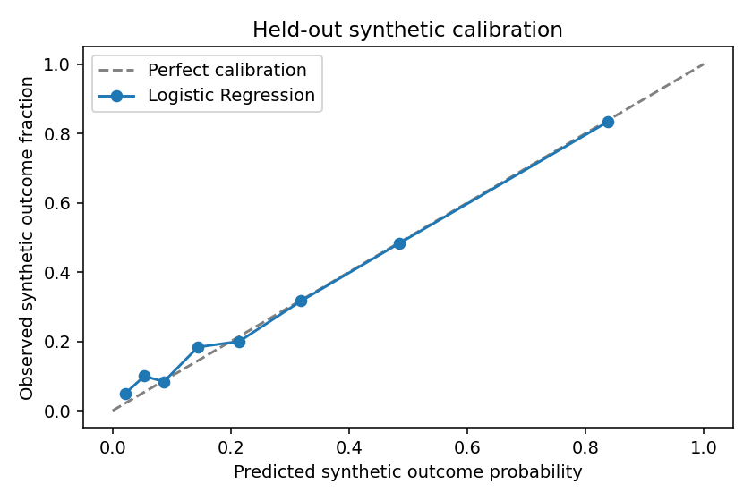

# Machine learning pipeline

The inference service is a genuine trained scikit-learn application. It is a research demonstration, not a validated lending engine. All predictions are served by Python FastAPI; no client-side heuristic substitutes for an unavailable model.

## Reproduce

From `ml-service` with Python 3.12:

```sh
python -m venv .venv
.venv/bin/python -m pip install -r requirements.lock.txt
OMP_NUM_THREADS=2 .venv/bin/python train.py
OMP_NUM_THREADS=2 .venv/bin/python -m pytest -q
OMP_NUM_THREADS=2 .venv/bin/python -m uvicorn app.main:app --host 127.0.0.1 --port 8000
```

On Windows replace `.venv/bin/python` with `.venv\Scripts\python.exe` and set `$env:OMP_NUM_THREADS="2"` in PowerShell. Training is an explicit operator action. The running service only loads artifacts and has no retraining endpoint. Changes require operator review, tests, a new model version and deployment.

`train.py` deterministically generates the synthetic dataset with seed 2026, computes versioned financial features, creates stratified 60/20/20 partitions, cross-validates Logistic Regression, Random Forest and Histogram Gradient Boosting on training data, fits candidates, and selects the lowest **validation** Brier score. No feature scaling is fitted on validation/test data. The final test set produces accuracy, precision, recall, F1, ROC-AUC, average precision (PR-AUC), Brier score, confusion matrix and eight quantile calibration bins. False-positive/negative interpretation uses an illustrative 0.5 binary threshold; UI risk bands are separately versioned review-priority conventions.

Artifacts: `artifacts/model.joblib` (trusted local model, never accept untrusted uploaded pickle/joblib files), `artifacts/metadata.json`, `artifacts/calibration.png`, and `datasets/synthetic-credit-v1.csv`. Metadata includes candidate hyperparameters, actual selected algorithm, dataset hash, metrics, ROC/PR curves, calibration, subgroup results, training timestamp and training reference distributions. Retraining with pinned dependencies and seed reproduces generated rows, splits, selection and model outputs; timestamp and serialized byte identity need not be identical.

## Features and calculations

Proposed monthly EMI uses the standard amortization formula. Zero interest returns principal/months. The implementation uses `log1p`/`expm1` for stability at near-zero rates.

- `dti`: (existing monthly EMI + proposed EMI) / monthly income.
- `emiToIncome`: proposed EMI / monthly income.
- `expenseToIncome`: monthly expenses / monthly income.
- `disposableIncome`: income − expenses − existing EMI − proposed EMI.
- `loanToIncome`: proposed principal / annual income.
- `debtToAnnualIncome`: existing outstanding debt / annual income.
- `creditScoreNormalized`: (score − 300) / 600. Missing score is imputed to 650 with a warning.
- `employmentYears`, `tenureYears`, `interestRate`.

Borrower names, age, identifiers, and protected demographic fields are not model inputs. Employment and financial inputs can nevertheless be proxies. Credit utilization is not calculated because credit-limit/balance inputs are unavailable. Loan purpose and employment type are collected as application descriptors but currently **not modeled**, so changes to them alone do not change predictions.

## Explainability

Predictions include genuine local SHAP values. Logistic Regression uses a linear explainer after training-fitted scaling; contributions add to log odds, with logistic transformation yielding the probability. Tree models use a tree explainer; Random Forest contributions add to probability while Gradient Boosting contributions add to log odds. Each response declares its scale and baseline. Tests reconstruct the returned prediction from baseline and contributions. These associations are not causal advice.

Global importance is held-out permutation ROC-AUC importance with eight repetitions and seed 2026. Negative values can arise from sampling variability; they are not hidden. Model metadata provides training mean/std and 5th/95th percentiles. Inference warns when values fall outside this central reference range. This is input-range monitoring, not a claim of statistically established production drift or real-world accuracy.

## Service API

- `GET /health`: `modelLoaded`, status and model version.
- `GET /model/info`: measured evaluation metadata and limitations.
- `POST /predict`, `POST /explain`: flat JSON financial input.
- `POST /predict/batch`: `{ "rows": [ input, ... ] }` (1–500 rows), order-preserving partial success results and indexed errors.
- `/docs` and `/openapi.json`: generated FastAPI contract.

Required fields: `monthlyIncome`, `monthlyExpenses`, `loanAmount`, `tenureMonths`. Optional defaults: `existingDebt=0`, `existingEmi=0`, `interestRate=12`, `employmentMonths=24`, `creditScore=null`, `employmentType="Salaried"`, `loanPurpose="Personal"`. Values must be finite; income/principal positive; tenure 1–600 months; score 300–900; interest 0–60%. Excess fields are ignored to allow submission of complete stored application objects, but never used as features.

With `ML_SERVICE_KEY` configured, all routes except health require `X-Service-Key`. Keep this service on a private network, not publicly exposed. Backend must send this key, browsers must never receive it. Missing artifacts cause a 503 rather than fabricated output. This service loads no arbitrary user-supplied artifact path.

## Measured synthetic evaluation

Executed in this environment on 480 untouched synthetic test rows: Logistic Regression was selected by validation Brier score. Test accuracy 0.8083, precision 0.7529, recall 0.4741, F1 0.5818, ROC-AUC 0.8228, average precision 0.7045, Brier score 0.1395. These are measurements on artificial labels, not banking performance claims.



## Distribution monitoring and registry integrity

`POST /monitor` accepts the same batch envelope as `/predict/batch`. It computes per-feature Population Stability Index (PSI) and prediction PSI against quantile histograms from the training partition. Empty buckets are smoothed to 1e-6. Thresholds 0.1/0.25 are explicitly demonstration indicators, not significance tests; samples under 100 rows receive a warning. Invalid-row count and missing-credit count support data-quality review. This does not measure model performance without actual labeled outcomes and does not prove drift in a real borrower population. The service retains no monitoring input.

Metadata includes nonprotected employment-duration, income and synthetic-credit-score cohorts. These subgroup metrics describe only the generated data and cannot certify demographic fairness.

Registered metadata records model artifact SHA256, training-configuration SHA256, versions of Python/scikit-learn/NumPy, model/data/feature/policy versions and timestamp. Startup verifies the artifact checksum before deserializing the trusted local joblib file. A checksum detects mismatch/corruption, not malicious substitution of both model and metadata; production artifact distribution requires separate trusted signing/storage controls.

The Python dependency closure is pinned in `requirements.lock.txt`. A pip-audit run against that complete lock on 2026-10-20 reported no known vulnerabilities after updating FastAPI, Starlette and pytest; audit output remains at `ml-service/artifacts/dependency-audit.json`. An audit is a point-in-time advisory check, not a guarantee of absence of security flaws.
